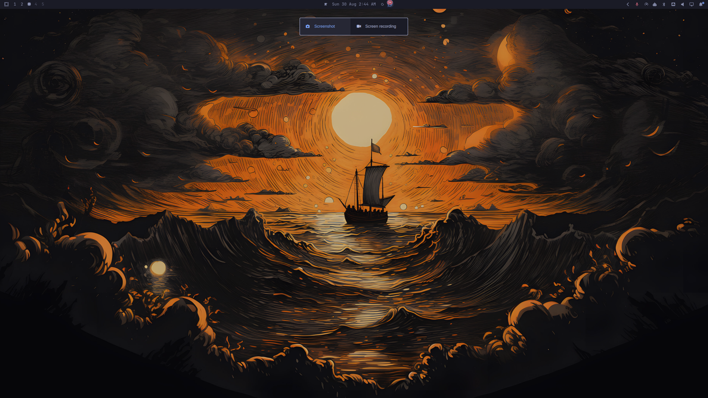

# Omarchy Snip & Record



A small Windows-like capture overlay for Omarchy. It keeps Omarchy's existing
screenshot and screen recording commands and changes only the way users start
them.

## Features

- Screenshot is selected by default.
- `Tab` switches between Screenshot and Screen recording.
- `Enter` starts the selected action.
- `Esc` closes the overlay or cancels the current selection.
- Direct pointer selection starts Screenshot.
- Screen recording continues through Omarchy's existing audio/webcam menu.
- The existing Omarchy status-bar recording indicator remains the stop control.
- The screen is dimmed while the overlay is open.

This plugin intentionally does not add countdown, pause, annotation, webcam,
or recording logic of its own.

## Installation

Install and enable the plugin directly from its published Git repository:

```bash
omarchy plugin add https://github.com/roubilibo/omarchy-snip-record.git --enable
```

The plugin manager places it in the user's Omarchy plugin directory and
reloads the shell.

## Shortcut setup

The plugin does not change shortcuts automatically. Add your preferred
binding to `~/.config/hypr/bindings.lua`:

```lua
hl.unbind("SUPER + SHIFT + S")
o.bind(
  "SUPER + SHIFT + S",
  "Omarchy Snip & Record",
  "omarchy-shell shell summon roubilibo.omarchy-snip-record '{}'"
)
```

Check existing shortcuts before overriding one:

```bash
omarchy menu keybindings --print
```

The existing `Print` screenshot and `Alt + Print` screen recording shortcuts
can remain unchanged.

## Requirements

- Omarchy shell with third-party overlay plugin support
- Omarchy's existing capture commands
- A configured screenshot and video directory

## License

MIT
